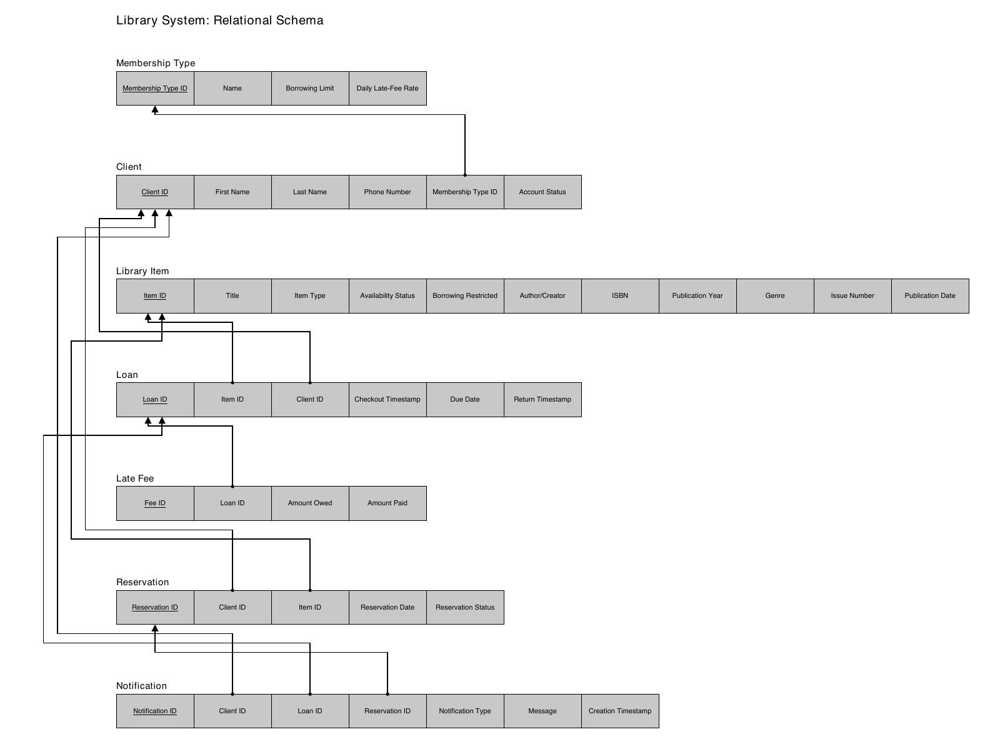

EECS 447 — Part 4: Logical Relational Model

## **1\. Introduction**

### **Project Overview**

The Library Management System stores items, clients, membership types, loans, reservations, notifications, and late fees for a small library. It supports catalog searches, checkouts and returns, borrowing rules, and reports. This part converts the ER model into database tables.

### **Scope**

The schema covers library items, client accounts, membership policies, loans, reservations, notifications, restrictions, and late fees. It defines the tables, attributes, data types, allowed values, keys, and functional dependencies. The project excludes a production interface and connections to outside library systems. SQL implementation and sample data come later.

### **Glossary**

Membership Type — A client category that sets the borrowing limit and daily late-fee rate.

Borrowing Limit — The maximum number of items a client may have checked out at once.

Daily Late-Fee Rate — The amount charged per day for an overdue item.

Domain — The values allowed in a field, such as permitted account statuses.

Functional Dependency (FD) — A rule where one value determines another, such as Membership Type ID determining the borrowing limit.

Referential Integrity — The rule that linked records must exist, such as a loan referring to an existing client.

## 

## **2\. Relational Schema Mapping**

### **ER to Relational Mapping Approach**

Each entity becomes a table, with its attributes as columns and its ID as the primary key. Library Item stores books, digital media, and magazines, identified by Item Type.

For a one-to-many relationship, the table on the many side stores the other table’s primary key as a foreign key. Late Fee stores a required, unique Loan ID, allowing at most one fee per loan.

Loan and Reservation link clients to items. Each has its own ID so the same client can borrow or reserve an item more than once.

### **Relations and Primary Keys**

| Relation | Attributes |
| :---- | :---- |
| Membership Type | Membership Type ID (PK), Name, Borrowing Limit, Daily Late-Fee Rate |
| Client | Client ID (PK), First Name, Last Name, Phone Number, Membership Type ID (FK), Account Status |
| Library Item | Item ID (PK), Title, Item Type, Availability Status, Borrowing Restricted, Author/Creator, ISBN, Publication Year, Genre, Issue Number, Publication Date |
| Loan | Loan ID (PK), Item ID (FK), Client ID (FK), Checkout Timestamp, Due Date, Return Timestamp |
| Late Fee | Fee ID (PK), Loan ID (FK, UNIQUE), Amount Owed, Amount Paid |
| Reservation | Reservation ID (PK), Client ID (FK), Item ID (FK), Reservation Date, Reservation Status |
| Notification | Notification ID (PK), Client ID (FK), Loan ID (FK, nullable), Reservation ID (FK, nullable), Notification Type, Message, Creation Timestamp |

Late Fee.Loan ID is unique and required. ISBN, names, and phone numbers are not unique identifiers.

### **Attributes and Domains**

The data dictionary lists each attribute’s type, allowed values, and constraints. Required text cannot be blank.

### **Foreign Keys and Relationship Constraints**

| Foreign key | Referenced primary key | Participation |
| :---- | :---- | :---- |
| Client.Membership Type ID | Membership Type.Membership Type ID | Required; one membership type per client. |
| Loan.Item ID | Library Item.Item ID | Required; one item per loan. |
| Loan.Client ID | Client.Client ID | Required; one client per loan. |
| Late Fee.Loan ID | Loan.Loan ID | Required and UNIQUE; zero or one fee per loan. |
| Reservation.Client ID | Client.Client ID | Required; one client per reservation. |
| Reservation.Item ID | Library Item.Item ID | Required; one item per reservation. |
| Notification.Client ID | Client.Client ID | Required; one recipient per notification. |
| Notification.Loan ID | Loan.Loan ID | Required for loan notices; otherwise null. |
| Notification.Reservation ID | Reservation.Reservation ID | Required for reservation notices; otherwise null. |

Every non-null foreign key must refer to an existing record. Records cannot be deleted while other records reference them. A loan or reservation may have multiple notifications.

### **Functional Dependencies**

The arrow (→) means that the value on the left determines the values on the right.

| Relation | Functional dependencies |
| :---- | :---- |
| Membership Type | Membership Type ID → Name, Borrowing Limit, Daily Late-Fee Rate |
| Client | Client ID → First Name, Last Name, Phone Number, Membership Type ID, Account Status |
| Library Item | Item ID → Title, Item Type, Availability Status, Borrowing Restricted, Author/Creator, ISBN, Publication Year, Genre, Issue Number, Publication Date |
| Loan | Loan ID → Item ID, Client ID, Checkout Timestamp, Due Date, Return Timestamp |
| Late Fee | Fee ID → Loan ID, Amount Owed, Amount Paid; Loan ID → Fee ID, Amount Owed, Amount Paid |
| Reservation | Reservation ID → Client ID, Item ID, Reservation Date, Reservation Status |
| Notification | Notification ID → Client ID, Loan ID, Reservation ID, Notification Type, Message, Creation Timestamp |

Membership Type ID determines the borrowing limit and daily fee rate. For notifications linked to loans, Loan ID determines Client ID; for reservation notices, Reservation ID determines Client ID.

### **Data Integrity and Business Rules**

* An item can have only one active loan at a time. A null Return Timestamp identifies an active loan.  
* Checkout must respect the membership borrowing limit, client account restrictions, and item borrowing restrictions.  
* Due Date must be on or after the checkout calendar date. Return Timestamp, when present, must be on or after Checkout Timestamp.  
* Reservations are for unavailable items. Each reservation identifies one existing client and item and uses a permitted status.  
* Each notification references exactly one loan or reservation, as determined by its type, and its Client ID must match the client on that record.  
* A loan has at most one late-fee record. Amount Owed and Amount Paid cannot be negative. The remaining balance is Amount Owed minus Amount Paid.  
* Availability Status must stay consistent with loan and reservation records.

## **3\. Relational Schema Diagram**

Underlined attributes are primary keys. Arrows connect foreign keys to the primary keys they reference.

## **4\. Schema Documentation & Data Dictionary**

IDs are positive integers. NN means required; required text cannot be blank. Nullable fields may be left empty where stated.

### **Membership Type**

| Attribute | Data type | Domain and constraints | Description |
| :---- | :---- | :---- | :---- |
| Membership Type ID | INTEGER | PK; NN; positive ID | Identifies a borrowing-policy category. |
| Name | VARCHAR(50) | NN; nonblank | Membership label, such as regular, student, or senior; not assumed unique. |
| Borrowing Limit | INTEGER | NN; 0 or more | Maximum simultaneous active loans. |
| Daily Late-Fee Rate | NUMERIC(6,2) | NN; 0 or more | Daily monetary charge for an overdue loan. |

### **Client**

| Attribute | Data type | Domain and constraints | Description |
| :---- | :---- | :---- | :---- |
| Client ID | INTEGER | PK; NN; positive ID | Identifies one library client. |
| First Name | VARCHAR(100) | NN; nonblank | Client’s given name. |
| Last Name | VARCHAR(100) | NN; nonblank | Client’s family name. |
| Phone Number | VARCHAR(32) | NN; nonblank | Contact number; permits international prefixes, spaces, punctuation, and extensions. |
| Membership Type ID | INTEGER | NN; FK → Membership Type.Membership Type ID | Client’s current membership category. |
| Account Status | VARCHAR(10) | NN; active, inactive, restricted | Controls account eligibility. |

### **Library Item**

| Attribute | Data type | Domain and constraints | Description |
| :---- | :---- | :---- | :---- |
| Item ID | INTEGER | PK; NN; positive ID | Identifies an individual collection item. |
| Title | VARCHAR(255) | NN; nonblank | Displayed catalog title. |
| Item Type | VARCHAR(13) | NN; book, digital\_media, magazine | Selects the applicable descriptive fields. |
| Availability Status | VARCHAR(12) | NN; available, on\_loan, reserved | Current circulation state; synchronized with loans and reservations. |
| Borrowing Restricted | BOOLEAN | NN; TRUE or FALSE | Indicates an item-specific prohibition on checkout. |
| Author/Creator | VARCHAR(255) | Required, nonblank for books/digital media; null for magazines | Creator credit for the item. |
| ISBN | VARCHAR(13) | Nullable; if present, 10 or 13 characters in normalized ISBN form | Optional edition identifier; not UNIQUE. Store without spaces or hyphens. |
| Publication Year | SMALLINT | Required for books/digital media; 1–9999; null for magazines | Year of publication. |
| Genre | VARCHAR(100) | Required, nonblank for books/digital media; null for magazines | Catalog genre label. |
| Issue Number | VARCHAR(50) | Required, nonblank for magazines; null otherwise | Magazine issue designation; may include letters or punctuation. |
| Publication Date | DATE | Required for magazines; null otherwise | Calendar publication date of the issue. |

### **Loan**

| Attribute | Data type | Domain and constraints | Description |
| :---- | :---- | :---- | :---- |
| Loan ID | INTEGER | PK; NN; positive ID | Identifies one checkout event. |
| Item ID | INTEGER | NN; FK → Library Item.Item ID | Borrowed item; unique among active loans. |
| Client ID | INTEGER | NN; FK → Client.Client ID | Client responsible for the loan. |
| Checkout Timestamp | TIMESTAMP WITH TIME ZONE | NN | Actual checkout instant. |
| Due Date | DATE | NN; on/after checkout date | Last calendar day before the loan becomes overdue. |
| Return Timestamp | TIMESTAMP WITH TIME ZONE | Nullable; on/after checkout | Null while active; records the return instant. |

### **Late Fee**

| Attribute | Data type | Domain and constraints | Description |
| :---- | :---- | :---- | :---- |
| Fee ID | INTEGER | PK; NN; positive ID | Identifies one fee assessment. |
| Loan ID | INTEGER | NN; UNIQUE; FK → Loan.Loan ID | Overdue loan associated with the fee. |
| Amount Owed | NUMERIC(10,2) | NN; 0 or more | Total assessed charge before payments, not the remaining balance. |
| Amount Paid | NUMERIC(10,2) | NN; 0 or more | Payments applied; balance \= Amount Owed − Amount Paid. |

### **Reservation**

| Attribute | Data type | Domain and constraints | Description |
| :---- | :---- | :---- | :---- |
| Reservation ID | INTEGER | PK; NN; positive ID | Identifies one reservation event. |
| Client ID | INTEGER | NN; FK → Client.Client ID | Client making the request. |
| Item ID | INTEGER | NN; FK → Library Item.Item ID | Requested individual item. |
| Reservation Date | DATE | NN | Request date in the library time zone. |
| Reservation Status | VARCHAR(10) | NN; pending, available, fulfilled, cancelled | Current request stage. |

### **Notification**

| Attribute | Data type | Domain and constraints | Description |
| :---- | :---- | :---- | :---- |
| Notification ID | INTEGER | PK; NN; positive ID | Identifies one notice. |
| Client ID | INTEGER | NN; FK → Client.Client ID | Recipient; must match the linked event’s client. |
| Loan ID | INTEGER | Nullable; FK → Loan.Loan ID | Required for upcoming-due or overdue notices; null for reservation notices. |
| Reservation ID | INTEGER | Nullable; FK → Reservation.Reservation ID | Required for reservation-availability notices; null for loan notices. |
| Notification Type | VARCHAR(21) | NN; upcoming\_due, overdue, reservation\_available | Determines which event reference is required. |
| Message | TEXT | NN; nonblank | Notification message. |
| Creation Timestamp | TIMESTAMP WITH TIME ZONE | NN | Time the notice record was created. |

Books and digital media require Author/Creator, Publication Year, and Genre; ISBN is optional. Magazines require Issue Number and Publication Date. Non-applicable fields are null.

Upcoming-due and overdue notifications require Loan ID and a null Reservation ID. Reservation-availability notifications require Reservation ID and a null Loan ID.

## 

## **Project Meeting Log**

**Date:** October 18th 

**Time:** 5-6pm 

**Location:** Virtual 

**Objective:** Delegate tasks for Part 4 of the project, focusing on expanding the ER diagram into a relational schema, defining relationships and constraints, and organizing the required documentation and deliverables.

**Team Members Present:** Mo, Pranav, Gabe, Karim, Daniel

### **Tasks Completed**

* Gabe: Created the relational schema diagram  
* Pranav: Completed project documentation and reviewed the final deliverables   
* Mo: Reviewed documentation and schema diagram  
* Daniel: Converted ER diagram entities into relational tables  
* Karim: Mapped relationships and identified foreign keys

### **Tasks Allocated**

* Gabe: Create relational schema diagram   
* Pranav: Complete project documentation and review final submission   
* Mo: record notes and assist with documentation   
* Daniel: Convert ER diagram into relational tables  
* Karim: Map relationships and identify foreign keys

**Deadline:** Sunday 10pm

### **Follow-Up Action**

Review  and Submit by Sunday 11:59